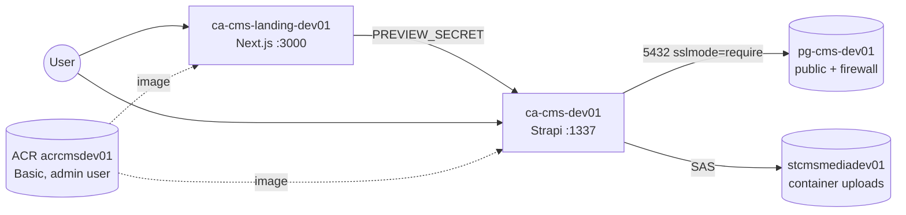
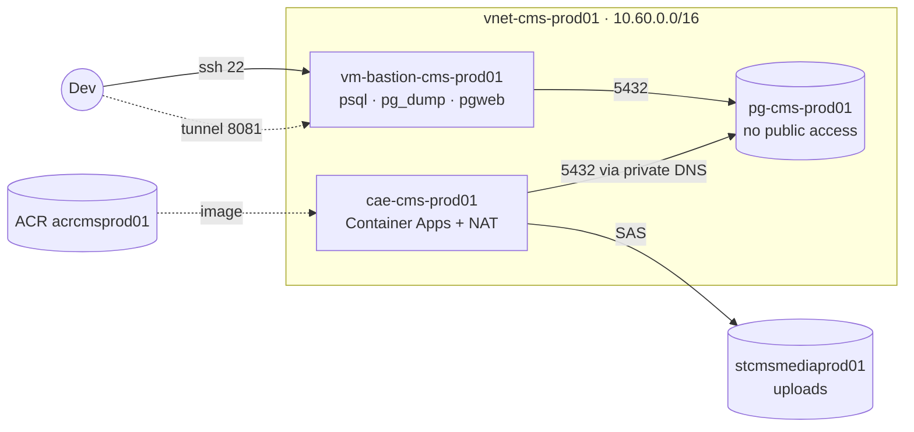

# infra

Terraform for the phunggela CMS infrastructure: ACR, PostgreSQL Flexible
Server, Container Apps (Strapi + landing), Blob storage, and — in prod only — a
VNet with a bastion VM.

Each env is a root module under `environments/`, sharing `modules/`. Resource
suffix is fixed per env: `dev01`, `prod01`.

## Diagrams

dev — no VNet, everything over public endpoints:



prod — same set of services, but Postgres lives inside the VNet:



In prod `cms` is enabled; `landing` is still commented out in
`environments/prod/main.tf`.

## Network

dev: no VNet. Postgres has public access enabled, with the firewall open for
`allowed_client_ips` plus the `0.0.0.0` Azure services rule, because the
Container Apps here have no fixed egress IP to allow-list.

prod uses `vnet-cms-prod01` and no firewall rules at all:

| Subnet | CIDR | Used for |
| --- | --- | --- |
| `snet-aca-prod01` | 10.60.0.0/24 | Container Apps environment, attached to the NAT gateway |
| `snet-pg-prod01` | 10.60.1.0/28 | Postgres, delegated |
| `snet-bastion-prod01` | 10.60.2.0/27 | Bastion VM, port 22 only |

Postgres resolves through the private DNS zone
`cms-prod01.postgres.database.azure.com`. ACA egresses through NAT with a
static public IP (`aca_egress_ip`). ACR and Blob remain public endpoints.

## Run

```bash
cd environments/dev          # or prod
cp terraform.tfvars.example terraform.tfvars

# State backend (Azure Blob); dev does not pin the subscription in the backend
export ARM_ACCESS_KEY="<storage-account-key>"
export ARM_SUBSCRIPTION_ID="<subscription-id>"   # dev only

terraform init
terraform plan -out=tfplan
terraform apply tfplan
```

Read the plan before applying, especially for unexpected destroy/replace —
the bastion VM's `custom_data` is ForceNew, so adding a tool recreates the VM.

Prod, optional — split the DB role for CMS:

```bash
openssl rand -base64 24            # password for the cms_app role
scp environments/prod/bootstrap/cms-db-user.sql bastion:
ssh ubuntu@<bastion-ip> -- psql \
  "host=<postgres-fqdn> port=5432 dbname=cms user=cmsadmin sslmode=require" \
  -v app_password='<password-above>' -f cms-db-user.sql
```

Then set `database_username = "cms_app"` and `database_password` (a new
sensitive variable or `random_password`) in `environments/prod/main.tf`.
The script is idempotent: it creates the role if missing, resets the password,
and re-grants the schema (including tables restored from a dump by the admin
user).
