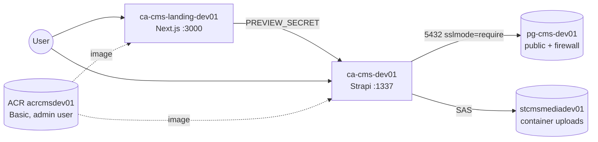
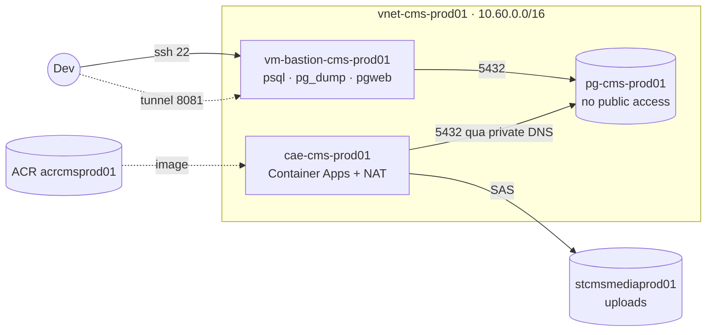

# infra

Terraform cho hạ tầng phunggela CMS: ACR, PostgreSQL Flexible Server, Container
Apps (Strapi + landing), Blob storage, và riêng prod thì có thêm VNet + bastion VM.

Mỗi env là một root module trong `environments/`, dùng chung `modules/`.
Suffix của resource cố định theo env: `dev01`, `prod01`.

## Sơ đồ

dev — không có VNet, mọi thứ đi qua endpoint public:



prod — cùng bộ service, nhưng Postgres nằm trong VNet:



`cms` và `landing` trong prod hiện đang bị comment, nên prod mới chỉ có
network + DB + registry + blob.

## Network

dev: không có VNet. Postgres bật public access, firewall mở cho
`allowed_client_ips` và rule `0.0.0.0` của Azure services, vì
Container Apps ở đây không có egress IP cố định để allow-list.

prod dùng `vnet-cms-prod01`, không có firewall rule nào:

| Subnet | CIDR | Dùng cho |
| --- | --- | --- |
| `snet-aca-prod01` | 10.60.0.0/24 | Container Apps environment, gắn NAT gateway |
| `snet-pg-prod01` | 10.60.1.0/28 | Postgres, delegated |
| `snet-bastion-prod01` | 10.60.2.0/27 | VM bastion, chỉ mở port 22 |

Postgres resolve qua private DNS zone `cms-prod01.postgres.database.azure.com`.
ACA ra ngoài bằng NAT + static public IP (`aca_egress_ip`). ACR và Blob vẫn là
endpoint public.

## Config

- `acr` — Basic, bật admin user. Dùng admin credential thay vì AcrPull vì
  principal hiện tại không tạo được role assignment.
- `postgres` — PG 16, database `cms`, user `cmsadmin`. Password để null thì
  module tự generate, đọc lại bằng `terraform output -raw db_password`.
  `database_url` luôn kèm `sslmode=require`.
- `aca` — một environment mỗi env, log đẩy vào Log Analytics 30 ngày. Workload
  profile `Consumption` khai báo ngay từ đầu vì environment thiếu profile thì
  không thêm được sau này.
- `blob` — StorageV2, container `uploads` cho phép anonymous read, ghi thì cần
  SAS. SAS có mốc thời gian cố định (`sas_start`/`sas_expiry`) nên không đổi
  mỗi lần apply.
- `cms` — Strapi, 1 CPU / 2Gi, max 1 replica. Tự sinh toàn bộ secret boot
  (APP_KEYS, JWT, salt, encryption key, PREVIEW_SECRET). Env
  `AZURE_STORAGE_*` lấy từ `blob`, DB lấy từ `postgres`, image lấy từ `acr`.
- `landing` — Next.js, 0.5 CPU / 1Gi, port 3000. Không khai báo HTTP probe vì
  `/api/preview` trả 401 và các route còn lại đều render data từ CMS, probe 2xx
  sẽ restart app mỗi khi CMS chết.
- `bastion` — Ubuntu 24.04, chỉ bật khi `enable_bastion_vm = true`. Có
  `psql`/`pg_dump`/`pg_restore` 16, Node 22, và pgweb chạy ở
  `127.0.0.1:8081` (chỉ vào được qua SSH tunnel, pgweb không có TLS).

## Kết nối giữa các module

`blob → cms` (SAS + container URL + CDN URL), `postgres → cms` (host, db, user,
password), `acr → cms/landing` (image + registry credential), `aca → cms/landing`
(environment id + default domain), `cms → landing` (chỉ mỗi `preview_secret`,
không generate lại vì hai bên phải khớp nhau).

Dev: khi CMS update secret thì app nhận revision mới, còn landing chỉ
quan tâm `PREVIEW_SECRET`. Prod: `landing` sẽ nối vào cùng environment sau khi
uncomment.

## State

Backend Azure Blob (`stcmsxs8ytf`, container `tfstate`), mỗi env một key:
`dev.terraform.tfstate`, `prod.terraform.tfstate`.
Storage account này tạo tay, không nằm trong Terraform.

`dev` không pin `subscription_id` trong backend (prod thì có), nên trước khi
`terraform init` cần export `ARM_SUBSCRIPTION_ID`.

```bash
export ARM_ACCESS_KEY="$(az storage account keys list \
  -g rg-cms-prod -n stcmsxs8ytf --query '[0].value' -o tsv)"
```

## Chạy

```bash
cd environments/dev          # hoặc prod
cp terraform.tfvars.example terraform.tfvars
terraform init
terraform plan -out=tfplan
terraform apply tfplan
```

Đọc plan trước khi apply, nhất là khi thấy destroy/replace ngoài dự kiến —
`custom_data` của bastion là ForceNew nên thêm tool là VM bị tạo lại.

## Vài thứ dễ quên

- `*.tfvars`, `.terraform/`, `*.tfstate` đều git-ignore; chỉ commit file
  `.example`.
- prod: đừng để `postgres_admin_password` null nếu server đã tồn tại, nó sẽ
  rotate password thật.
- dev: `postgres_allow_azure_services = true` phải bật trước khi tạo
  app đầu tiên, không thì app không nối được DB.
- Bastion: `terraform output -raw bastion_pgweb_tunnel_command`, rồi mở
  `http://127.0.0.1:8081` và paste `database_url`.
