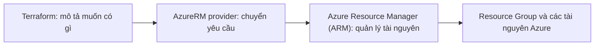
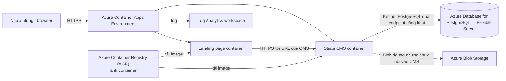
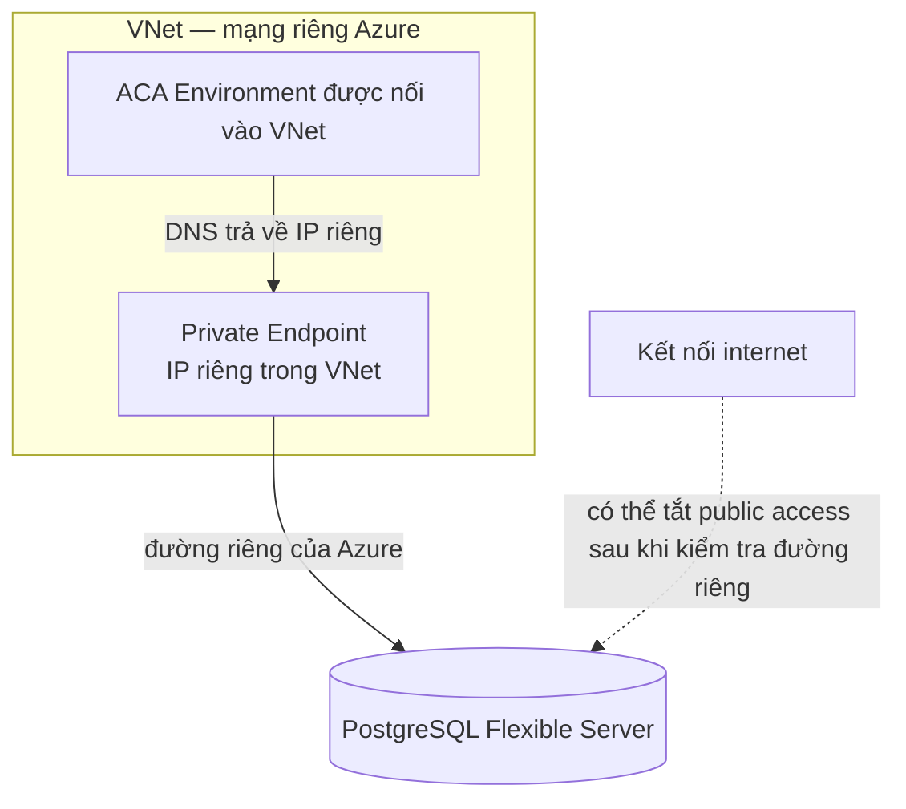

# Azure dễ hiểu — bản đọc lại cho repo CMS

> Đây là **một bản giải thích mới**, viết đơn giản hơn `docs/azure-primer.vi.md`.
> File primer cũ vẫn được giữ nguyên. Nội dung dưới đây tập trung vào cách đọc kiến trúc
> trong repo này; phần nào chưa được triển khai sẽ được ghi rõ.

## 1. Từ khóa cần biết trước

Đọc phần này trước để các chữ viết tắt phía dưới không bị khó hiểu.

| Từ khóa | Tên đầy đủ | Nghĩa đơn giản |
|---|---|---|
| **ARM** | **Azure Resource Manager** | Lớp quản lý của Azure: nhận lệnh tạo, sửa, xóa tài nguyên. ARM không phải loại CPU. |
| **AWS** | **Amazon Web Services** | Tên nền tảng đám mây của Amazon. |
| **RG** | **Resource Group** | Nhóm tài nguyên liên quan trong Azure. Xóa nhóm có thể xóa toàn bộ tài nguyên bên trong. |
| **VNet** | **Virtual Network** | Mạng riêng trong Azure, gần giống VPC của AWS. |
| **VPC** | **Virtual Private Cloud** | Mạng riêng trong AWS. Đây là khái niệm gần nhất với VNet. |
| **ACA** | **Azure Container Apps** | Dịch vụ chạy ứng dụng đóng gói trong container; repo dùng để chạy CMS và trang landing. |
| **ACR** | **Azure Container Registry** | Kho lưu ảnh container của Azure; app tải ảnh từ đây khi chạy. |
| **ECR** | **Amazon Elastic Container Registry** | Kho ảnh container của AWS; gần giống ACR. |
| **CMS** | **Content Management System** | Hệ thống quản lý nội dung; trong repo này là Strapi. |
| **PaaS** | **Platform as a Service** | Dịch vụ mà nhà cung cấp quản lý phần lớn máy chủ/hệ điều hành; bạn cấu hình ứng dụng và dữ liệu. |
| **IaC** | **Infrastructure as Code** | Mô tả hạ tầng bằng mã cấu hình thay vì tạo từng món bằng tay; Terraform là công cụ IaC. |
| **API** | **Application Programming Interface** | Cổng/lời gọi để chương trình yêu cầu một dịch vụ thực hiện việc gì đó. |
| **RBAC** | **Role-Based Access Control** | Cách Azure cấp quyền theo vai trò, người/ứng dụng nhận vai trò trên một phạm vi tài nguyên. |
| **IAM** | **Identity and Access Management** | Hệ thống danh tính và quyền của AWS; tương tự về mục đích với RBAC của Azure, nhưng cách gán quyền khác. |
| **NSG** | **Network Security Group** | Bộ luật cho phép/chặn luồng mạng trong VNet. Có thể gắn vào subnet hoặc giao diện mạng. |
| **UDR** | **User-Defined Route** | Tuyến mạng do bạn tự khai báo để điều khiển traffic đi đâu. |
| **NAT** | **Network Address Translation** | Cách cho máy trong mạng riêng đi ra ngoài bằng địa chỉ IP công cộng; NAT Gateway của Azure có thể cung cấp IP đi ra ổn định. |
| **PE** | **Private Endpoint** | Một địa chỉ IP riêng trong VNet để kết nối tới dịch vụ Azure mà không cần đi qua địa chỉ công cộng. |
| **DNS** | **Domain Name System** | Hệ thống đổi tên miền thành địa chỉ IP. |
| **FQDN** | **Fully Qualified Domain Name** | Tên máy chủ đầy đủ, ví dụ `app.example.azurecontainerapps.io`. |
| **HTTPS** | **Hypertext Transfer Protocol Secure** | Kết nối web được mã hóa; thường đi qua cổng 443. |
| **TLS** | **Transport Layer Security** | Cơ chế mã hóa kết nối; HTTPS dùng TLS. |
| **WAF** | **Web Application Firewall** | Tường lửa kiểm tra request web, ví dụ chặn một số mẫu tấn công hoặc giới hạn tần suất. |
| **CDN** | **Content Delivery Network** | Mạng máy chủ ở nhiều vị trí giúp phân phối nội dung gần người dùng hơn. |
| **AZ** | **Availability Zone** | Một vùng trung tâm dữ liệu riêng biệt bên trong một Azure Region. |
| **HA** | **High Availability** | Thiết kế tăng khả năng dịch vụ tiếp tục chạy khi một máy hoặc vùng gặp lỗi. |
| **PITR** | **Point-in-Time Recovery** | Khôi phục cơ sở dữ liệu về một thời điểm trong khoảng ngày còn backup. |
| **SAS** | **Shared Access Signature** | Token có giới hạn quyền và thời hạn, dùng để cấp quyền truy cập tài nguyên lưu trữ Azure. |
| **S3** | **Amazon Simple Storage Service** | Dịch vụ lưu trữ object của AWS; gần giống Azure Blob Storage. |
| **RDS** | **Amazon Relational Database Service** | Dịch vụ cơ sở dữ liệu được quản lý của AWS. |
| **ECS** | **Amazon Elastic Container Service** | Dịch vụ điều phối container của AWS. |
| **ALB** | **Application Load Balancer** | Bộ cân bằng tải ứng dụng của AWS, xử lý traffic web ở lớp HTTP/HTTPS. |
| **Fargate** | **AWS Fargate** | Cách chạy container của AWS mà không tự quản lý máy chủ. |
| **CloudFormation** | **AWS CloudFormation** | Công cụ IaC của AWS; không phải tên khác của ARM. |
| **Route 53** | **Amazon Route 53** | Dịch vụ DNS của AWS; có thể so sánh với Azure DNS ở một số chức năng. |
| **AzureRM provider** | **Azure Resource Manager provider** | Plugin của Terraform dùng để quản lý tài nguyên Azure qua ARM. |
| **CPU** | **Central Processing Unit** | Bộ xử lý của máy tính; ARM trong tài liệu này không nói về CPU. |
| **HTTP** | **Hypertext Transfer Protocol** | Giao thức truyền dữ liệu web; HTTPS là kết nối HTTP được bảo vệ bằng TLS. |
| **IP** | **Internet Protocol** | Quy tắc định tuyến mạng; địa chỉ IP giúp xác định điểm đến trên mạng. |
| **URL** | **Uniform Resource Locator** | Địa chỉ đầy đủ của một trang hoặc tài nguyên trên web. |
| **Azure Private Link** | **Azure Private Link** | Công nghệ Azure cung cấp kết nối riêng tới dịch vụ; Private Endpoint là điểm kết nối vào VNet. |
| **Managed Identity** | **Managed Identity** | Danh tính Azure cấp cho ứng dụng/tài nguyên để gọi dịch vụ khác mà không phải tự quản lý mật khẩu; vẫn cần được cấp quyền RBAC. |
| **AcrPull** | **AcrPull role** | Vai trò Azure cho phép đọc/tải image từ Azure Container Registry. |
| **DB** | **Database** | Cơ sở dữ liệu; nơi ứng dụng lưu và đọc dữ liệu. |
| **Network interface** | **Network Interface** | Giao diện mạng ảo nối một máy hoặc tài nguyên vào mạng. |
| **Workload profile** | **Workload profile** | Lựa chọn loại năng lực tính toán mà Container Apps Environment dùng cho các app. |
| **AWS PrivateLink** | **AWS PrivateLink** | Dịch vụ AWS tạo kết nối riêng từ VPC tới dịch vụ mà không cần public IP. |
| **Replica** | **Replica** | Một bản chạy của ứng dụng; nhiều replica có thể cùng xử lý request. |
| **Contributor role** | **Contributor** | Vai trò cho phép tạo/sửa/xóa tài nguyên trong phạm vi được cấp; không tự cho phép gán quyền RBAC. |

**Một số từ thường gặp:**

- **Ingress**: traffic đi **vào** ứng dụng; **egress**: traffic đi **ra** ứng dụng/mạng.
- **Public endpoint**: địa chỉ có thể được định tuyến từ internet; vẫn có thể bị giới hạn bởi firewall.
- **Private endpoint**: địa chỉ riêng chỉ dùng được từ mạng có đường kết nối phù hợp.
- **Origin**: máy chủ đích mà dịch vụ như Front Door chuyển request đến.
- **Revision**: một phiên bản cấu hình/triển khai của ứng dụng container.
- **SKU (Stock Keeping Unit)**: tên gói cấu hình, thường quyết định kích thước máy, khả năng và giá.
- **Principal**: danh tính đang thực hiện thao tác, có thể là người dùng hoặc ứng dụng tự động.

## 2. Bức tranh lớn: Terraform, ARM và tài nguyên Azure

Hãy hình dung hai luồng riêng:



- Terraform đọc các file `.tf` và gửi yêu cầu tạo/cập nhật tài nguyên qua AzureRM provider.
- **ARM là lớp quản lý**, không phải nơi request của người dùng đi qua khi mở website.
- Sau khi được tạo, dữ liệu giữa các dịch vụ chạy trực tiếp khi ứng dụng hoạt động; không đi vòng qua ARM.
- Trong AWS, mỗi dịch vụ có API quản lý riêng; **AWS CloudFormation là công cụ triển khai IaC**, không phải một dịch vụ quản lý API tập trung giống ARM.

Trong repo này, cấu trúc tổ chức là:

```text
Azure Subscription
└── Resource Group có sẵn (ví dụ rg-cms-prod)
    ├── Container Apps Environment
    ├── Ứng dụng CMS và landing
    ├── PostgreSQL Flexible Server
    ├── Container Registry
    └── Storage Account / Blob container
```

Repo tra cứu Resource Group đã có, không tạo Resource Group đó trong module. Resource Group giống một nhóm quản lý vòng đời hơn là một máy chủ. AWS Account gần với **Subscription**; AWS không có Resource Group tương đương hoàn toàn. Tag hoặc một bộ tài nguyên do CloudFormation quản lý chỉ giống một phần vì không tự gom mọi tài nguyên theo cùng cách.

## 3. Sơ đồ hiện tại trong repo

Repo hiện chạy các ứng dụng và cơ sở dữ liệu trên endpoint công khai; **chưa có VNet, Private Endpoint hay Front Door**.



Cách đọc sơ đồ:

1. Người dùng vào URL của ứng dụng qua HTTPS.
2. Container Apps Environment định tuyến request đến app phù hợp. Mỗi app có URL mặc định riêng.
3. Landing gọi CMS; CMS kết nối tới PostgreSQL.
4. ACR giữ ảnh container để app sử dụng.
5. Log Analytics nhận log từ environment.
6. Blob Storage đã được khai báo, nhưng README xác nhận CMS hiện chưa được nối với Blob. Vì vậy không nên hiểu sơ đồ là ảnh upload của CMS đã được lưu ở đó.

### Hiện trạng cần nhớ

- **Azure Container Apps (ACA)** và PostgreSQL đều được cấu hình có đường truy cập công khai trong repo.
- PostgreSQL dùng firewall rules; ví dụ `terraform.tfvars.example` cho phép các IP máy phát triển và đặt `postgres_allow_azure_services = true`.
- Module chỉ tạo rule `0.0.0.0` khi `allow_azure_services` bật. Rule này có nghĩa **cho phép kết nối từ Azure services**, kể cả subscription của khách hàng Azure khác; không có nghĩa là chặn tất cả, cũng không đồng nghĩa cho mọi địa chỉ internet.
- Giá trị thật có thể nằm trong `terraform.tfvars` không được commit. Xem cấu hình của môi trường và trạng thái Azure trước khi kết luận cấu hình đang chạy.
- Không có VNet thì không có NSG/UDR của repo để lọc traffic giữa ACA và PostgreSQL.

## 4. Các dịch vụ đang dùng

### 4.1 Azure Container Apps (ACA): nơi chạy ứng dụng

Có hai tầng:

- **Environment**: vỏ dùng chung cho các app, có domain chung và cấu hình log/workload.
- **Container App**: ứng dụng cụ thể, gồm ảnh container, cổng, biến môi trường, secret và cách scale.

Trong repo, một environment chạy Strapi CMS và landing page. ACA quản lý ingress web, chứng chỉ HTTPS cho domain mặc định, và chuyển request đến revision được chọn. Vì vậy không cần tự tạo Application Load Balancer chỉ để có URL cơ bản.

**ACA không có nghĩa mọi app đều riêng tư.** Trong cấu hình hiện tại, app bật ingress công khai. Có thể tắt ingress công khai cho app chỉ dùng nội bộ cùng environment, nhưng đó không tự làm PostgreSQL riêng tư.

Mỗi lần đổi cấu hình quan trọng như image hoặc biến môi trường có thể tạo revision mới. Repo dùng chế độ `Single`: chỉ một revision nhận traffic tại một thời điểm. `min_replicas = 0` cho phép ACA chạy app từ 0 replica khi quy tắc scale phù hợp; request đầu có thể phải chờ app khởi động. Trong module repo, CMS chỉ đặt mức tối thiểu về 0 khi `cms_paused = true`; landing luôn giữ ít nhất một replica.

### 4.2 PostgreSQL Flexible Server: cơ sở dữ liệu

Tên đầy đủ của dịch vụ là **Azure Database for PostgreSQL — Flexible Server**. Đây là PostgreSQL do Azure quản lý; trong repo nó chứa database `cms`.

Trong code, `public_network_access_enabled = true`: server có public access. Firewall rule quyết định dải địa chỉ nào được kết nối. Kết nối ứng dụng tới DB dùng cổng PostgreSQL `5432`.

`0.0.0.0` là rule đặc biệt của PostgreSQL trên Azure: nó cho phép kết nối từ Azure services. Vì có thể bao gồm dịch vụ của subscription khác, đây là lựa chọn cần hiểu rõ, không phải một firewall rule nhỏ vô hại. Mật khẩu và TLS vẫn quan trọng, nhưng không thay thế việc thu hẹp quyền truy cập mạng khi có thể.

Backup và **Point-in-Time Recovery (PITR)** cho phép khôi phục dữ liệu trong khoảng retention đã cấu hình. Backup không thay thế bản sao độc lập nếu cần bảo vệ trước sự cố xóa cả môi trường/tài khoản.

### 4.3 Azure Container Registry (ACR): kho ảnh ứng dụng

ACR giữ image container, tức gói chạy của CMS và landing. Container Apps lấy image từ ACR khi deploy/chạy. ACR có thể được so sánh với Amazon Elastic Container Registry (ECR): cả hai là registry ảnh container, nhưng quyền truy cập và luật mạng theo cách riêng của từng cloud.

`terraform.tfvars.example` bật tài khoản admin của ACR để cấp thông tin đăng nhập cho app. Module ghi rằng danh tính triển khai có quyền `Contributor` nhưng không có quyền gán `AcrPull`. Khi được cấp quyền RBAC phù hợp, có thể dùng Managed Identity + `AcrPull` thay cho tài khoản admin.

### 4.4 Azure Blob Storage: lưu file/object

Blob Storage là kho file dạng object của Azure, gần nhất với Amazon Simple Storage Service (S3). Repo tạo storage account và container `uploads`; container được cấu hình cho phép đọc ẩn danh, còn ghi cần thông tin cấp quyền như SAS.

Điểm quan trọng của repo: **tạo Blob không tự làm CMS sử dụng Blob**. README nói module Blob hiện chưa nối vào module CMS; ảnh Strapi ghi vào hệ thống file tạm bên trong container có thể mất khi container bị thay thế/khởi động lại.

### 4.5 Log Analytics workspace: nơi nhận log

Azure Container Apps gửi log tới Log Analytics workspace. AWS có các chức năng gần giống trong Amazon CloudWatch Logs, nhưng cách cấu hình, truy vấn và tích hợp không giống hệt.

## 5. Mạng riêng là gì, và hai cách làm DB riêng khác nhau ra sao?

### Virtual Network (VNet)

VNet là mạng riêng Azure. Trong VNet có subnet; NSG có thể lọc traffic và route table/UDR có thể định tuyến traffic. Nhưng **chỉ tạo VNet không tự chặn internet**. Muốn kiểm soát luồng mạng cần cấu hình các luật và đường đi phù hợp.

So sánh với Amazon Virtual Private Cloud (VPC): hai dịch vụ đều tạo mạng riêng. Một khác biệt đáng nhớ là Azure NSG có thể gắn ở subnet hoặc giao diện mạng; AWS Security Group gắn với giao diện mạng. Route table và luật mạng cũng được tạo/gắn theo cách của từng nền tảng.

### Private Endpoint và VNet Integration không phải cùng một thứ



- **Private Endpoint (PE)**: tạo một điểm vào có IP riêng trong VNet để kết nối tới một dịch vụ Azure. PostgreSQL vẫn ở chế độ mạng truy cập công khai; Private Endpoint thêm một đường riêng. Có thể tắt public network access sau khi đường riêng hoạt động.
- **VNet Integration / private access**: đưa PostgreSQL vào subnet được dành riêng cho dịch vụ. Đây là một chế độ mạng khác; theo README của repo, không dùng chế độ này nếu cần Private Endpoint cho PostgreSQL.
- Để ACA gọi được PE, ACA Environment cũng cần được nối vào VNet có đường tới endpoint. Chỉ tạo PE mà ACA vẫn ở ngoài VNet là chưa đủ.
- DNS phải trỏ tên DB đến IP riêng từ trong VNet. Khi DNS được cấu hình đúng, ứng dụng thường vẫn dùng cùng tên server; phần đổi là cách tên đó được phân giải.

### NAT Gateway: IP ổn định cho traffic đi ra

NAT Gateway dùng để ứng dụng trong subnet đi ra internet bằng IP công cộng ổn định. Nó không tự tạo đường vào ứng dụng từ internet. AWS cũng có NAT Gateway; Azure và AWS khác cách gán/định giá IP và cách nối vào subnet, nhưng mục đích chính tương tự.

### Azure Front Door: lớp web phía trước, không phải dịch vụ cấp domain bắt buộc

Azure Front Door có thể nhận request ở nhiều khu vực, chuyển request đến origin, cache nội dung và áp dụng Web Application Firewall (WAF). Nó gần với **kết hợp** Amazon CloudFront và AWS WAF, không phải bản sao chính xác của một dịch vụ AWS duy nhất.

ACA đã có domain mặc định và HTTPS; vì vậy Front Door không bắt buộc chỉ để có domain. Front Door hữu ích khi cần WAF, CDN/cache, hoặc một hostname ổn định dù origin đổi.

**Lưu ý:** Front Door Standard không tự làm origin riêng tư. Nếu ACA vẫn public, người dùng có thể gọi thẳng URL ACA để bỏ qua Front Door, trừ khi giới hạn truy cập ở origin. Private origin cần thiết kế khác, chẳng hạn Front Door Premium với Private Link và ACA internal environment.

## 6. Azure và AWS: so sánh có hướng rõ ràng

Các hàng dưới đây là **Azure → AWS gần nhất**. Đây là cách nhớ chức năng, không có nghĩa hai dịch vụ giống hoàn toàn.

| Azure | AWS gần nhất | Khác biệt cụ thể |
|---|---|---|
| **Azure Resource Manager (ARM)** | API quản lý riêng của từng dịch vụ AWS; AWS CloudFormation cho IaC | ARM là lớp quản lý tài nguyên tập trung của Azure. CloudFormation dựng hạ tầng AWS nhưng không phải lớp API quản lý tài nguyên AWS. |
| **Subscription** | AWS Account | Cả hai tạo ranh giới quản lý và thanh toán/hạn mức, nhưng cấu trúc quyền khác nhau. |
| **Resource Group (RG)** | Không có một dịch vụ tương đương; tag hoặc CloudFormation chỉ tương tự một phần | RG là nhóm tài nguyên Azure; xóa RG có thể xóa các tài nguyên bên trong. CloudFormation chỉ quản lý nhóm tài nguyên được khai báo trong cấu hình của nó. |
| **Virtual Network (VNet)** | Amazon Virtual Private Cloud (VPC) | Cùng vai trò mạng riêng; cách gắn luật, route và kết nối dịch vụ khác nhau. |
| **Network Security Group (NSG)** | AWS Security Group | NSG Azure gắn được vào subnet hoặc network interface; Security Group của AWS gắn với network interface. Không nên bê nguyên luật từ cloud này sang cloud kia. |
| **Azure Container Apps (ACA)** | Amazon Elastic Container Service (ECS) trên AWS Fargate, thường cộng Application Load Balancer (ALB) | ACA gộp nhiều phần như chạy app, ingress, domain và revision. Với ECS/Fargate, thường phải cấu hình các resource liên quan riêng hơn. |
| **Azure Container Registry (ACR)** | Amazon Elastic Container Registry (ECR) | Cùng vai trò kho image; danh tính, quyền tải image và luật mạng không giống nhau. |
| **Azure Database for PostgreSQL — Flexible Server** | Amazon Relational Database Service (RDS) for PostgreSQL | Cùng là PostgreSQL được quản lý. Trong repo, Azure bật public network access và dùng firewall rule; RDS chạy trong VPC, còn khả năng truy cập từ internet được điều khiển bằng cấu hình public access và Security Group. Không nên kết luận mọi RDS luôn private. |
| **Private Endpoint** | Interface VPC Endpoint + AWS PrivateLink | Cùng ý tưởng tạo đường riêng tới dịch vụ; Azure và AWS khác tài nguyên, API và DNS cần cấu hình. |
| **Azure NAT Gateway** | AWS NAT Gateway | Cùng cho subnet đi ra ngoài; cách gán IP công cộng và tính phí khác nhau. |
| **Azure Front Door** | Amazon CloudFront + AWS WAF | Front Door gộp định tuyến toàn cầu, CDN và WAF trong một dịch vụ; AWS thường phối hợp CloudFront và WAF riêng. Origin công khai vẫn có thể bị gọi trực tiếp ở cả hai nếu không giới hạn. |
| **Azure Blob Storage** | Amazon Simple Storage Service (S3) | Cùng lưu object/file; API, URL, quyền truy cập và kiểu token không giống nhau. |
| **Private DNS Zone** | Route 53 private hosted zone | Cùng phục vụ tên miền nội bộ; liên kết mạng và cách tự động tạo record khác nhau. |
| **Log Analytics workspace** | Amazon CloudWatch Logs | Cùng thu thập log; ngôn ngữ truy vấn và tích hợp khác nhau. |
| **Azure Role-Based Access Control (RBAC)** | AWS Identity and Access Management (IAM) | Azure thường gán một role cho principal trên phạm vi tài nguyên; AWS dùng các tập luật quyền gắn với danh tính/tài nguyên. Mô hình quyền không chuyển đổi một-một. |

## 7. Các quyết định cần để ý trước khi đổi hạ tầng

1. **Nối subnet VNet vào ACA Environment sẽ thay environment trong lộ trình của repo.** Các app phụ thuộc vào environment cũng bị tạo lại và domain mặc định có thể đổi.
2. **Chế độ mạng PostgreSQL cần chọn có chủ đích.** Private Endpoint và VNet integration là hai cách khác nhau; repo khuyến nghị giữ chế độ mạng truy cập công khai nếu cần Private Endpoint.
3. **Blob hiện chưa lưu ảnh thay cho CMS.** Muốn dữ liệu upload bền vững phải nối provider/lưu trữ vào CMS, không chỉ tạo Storage Account.
4. **Đọc `terraform plan` trước khi apply.** Nếu plan thay thế database hoặc environment, hãy hiểu rõ ảnh hưởng dữ liệu, URL và downtime trước khi xác nhận.
5. **Quyền deploy ảnh hưởng cách xác thực ACR.** Contributor không tự có quyền gán role cho identity khác; cần người có quyền RBAC phù hợp để chuyển sang Managed Identity + `AcrPull`.

## 8. Đọc tiếp trong repo

| Muốn biết | File bắt đầu xem |
|---|---|
| Các resource nào được tạo và cách chúng nối với nhau | `environments/<env>/main.tf` |
| Environment ACA và Log Analytics | `modules/aca/main.tf` |
| App CMS, ingress và secret | `modules/headless-cms/main.tf` |
| App landing | `modules/landing/main.tf` |
| PostgreSQL và firewall rule | `modules/postgres/main.tf` |
| Registry image | `modules/acr/main.tf` |
| Blob Storage, container và SAS | `modules/blob/main.tf` |
| Cách sử dụng repo và trạng thái networking | `README.md` |
| Lưu ý vận hành production | `docs/production-plan.vi.md` |

Nguồn sự thật cho cấu hình là Terraform và cấu hình môi trường đang dùng. File này giải thích khái niệm; không thay thế việc kiểm tra `terraform.tfvars`, `terraform plan` hoặc cấu hình thực tế trên Azure.
