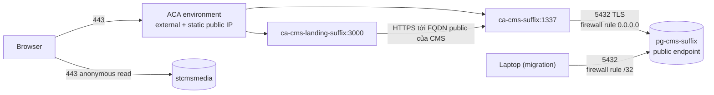
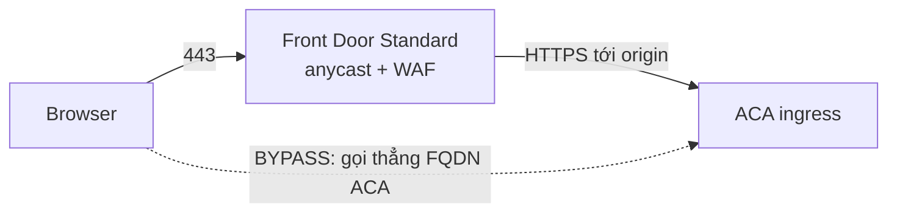
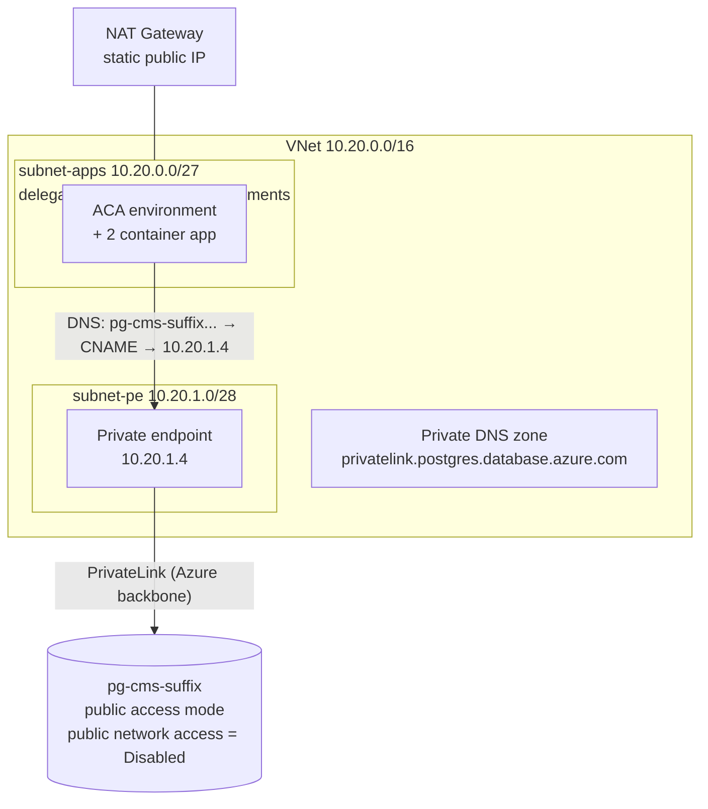
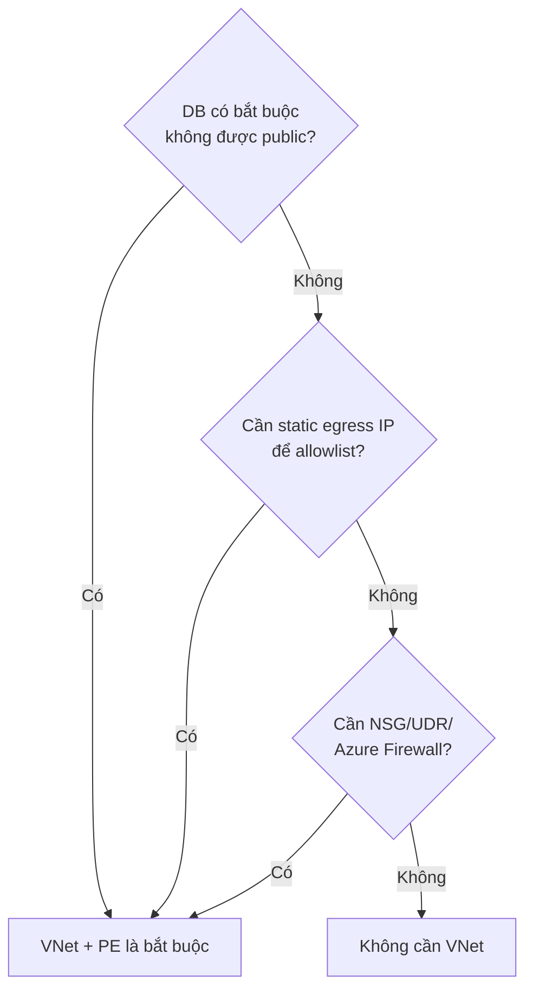

# Azure từ góc nhìn AWS — primer cho repo infra này

Mục đích: giải thích **từ đầu** các thành phần đang có trong repo (`VNet`, `Front Door`,
`Container Apps`, `PostgreSQL Flexible Server`) và **cách chúng ráp với nhau**, kèm bảng
đối chiếu sang khái niệm AWS quen thuộc.

Đọc theo thứ tự: §1 → §2 → §3 → §5 → §6. §4 là tra cứu từng thành phần.

---

## 1. Năm phút để hiểu đúng nhất

Nếu bạn chỉ nhớ 6 điều từ file này, nhớ 6 điều sau:

1. **Azure không có "VPC mặc định an toàn" như AWS.** RDS của bạn private theo mặc định; còn
   PostgreSQL Flexible Server của Azure **public theo mặc định** — nó có FQDN public, có
   firewall riêng, và ai có mật khẩu đúng thì vào được từ internet. "Private" ở Azure là thứ
   bạn phải **chủ động dựng thêm** (private endpoint hoặc VNet integration).
2. **Container Apps có sẵn load balancer + TLS + domain.** Bạn không tạo ALB. Mỗi app lấy
   `https://<tên-app>.<default-domain-của-environment>`. Không cần VNet, không cần Front Door.
3. **VNet ở Azure là opt-in cho PaaS.** Không có VNet thì vẫn chạy được, và mặc định là chạy
   ngoài VNet. VNet chỉ cần khi bạn muốn *kiểm soát đường mạng* (chặn, route, private IP).
4. **Private Endpoint ≠ VNet Integration.** Đây là hai cơ chế khác nhau của cùng một dịch vụ
   PaaS, và với PostgreSQL Flexible Server thì **loại trừ nhau**: chọn một trong hai. Repo
   này chọn "public access + private endpoint" khi cần private.
5. **Front Door là CDN/WAF toàn cầu, không phải "cách để có domain".** Domain cho ACA lấy
   trực tiếp từ ACA (bind custom domain + managed cert miễn phí). Front Door thêm WAF, cache,
   và một hostname ổn định độc lập với origin.
6. **Có những thứ chỉ chọn được lúc tạo, không sửa được về sau.** Với kiến trúc này, quan
   trọng nhất: network type của Container Apps environment, networking mode của PostgreSQL,
   storage type, geo-redundant backup. Đổi = tạo mới + migrate. Xem §6.

---

## 2. Azure vs AWS: bảng đối chiếu

### 2.1 Nền tảng

| Khái niệm Azure | Tương đương AWS | Ghi chú khác biệt |
|---|---|---|
| Subscription | AWS Account | Ranh giới billing + quota + RBAC |
| Resource Group | Không có tương đương trực tiếp (gần nhất: tag/stack) | Một "thư mục" chứa resource cùng vòng đời; xoá RG = xoá hết bên trong. Tên resource chỉ cần unique trong RG |
| Region | Region | `southafricanorth` = Johannesburg |
| Availability Zone (1/2/3) | AZ (a/b/c) | Gán zone cho một số resource là **vĩnh viễn** (Postgres) |
| Azure Resource Manager (ARM) | CloudFormation/API control plane | Mọi resource đi qua ARM; Terraform nói chuyện với ARM |
| Resource provider registration | Không có | `Microsoft.App`, `Microsoft.DBforPostgreSQL`… phải được "đăng ký" ở subscription trước khi tạo resource. Repo này tắt tự đăng ký (`resource_provider_registrations = "none"`) vì principal không có quyền |
| RBAC (role assignment) | IAM policy + role | Gán role cho *principal* trên *scope* (subscription/RG/resource). Không có "trust policy" như IAM role |
| Managed Identity | IAM Role gắn vào resource | Nhưng vẫn phải **gán RBAC** cho nó; identity tự sinh, không cần trust policy |
| `Contributor` role | Quyền CRUD resource | **Không** tạo được role assignment (việc đó cần `Owner`/`User Access Administrator`). Đây là lý do repo dùng ACR admin user thay vì `AcrPull` |
| Policy / Blueprint | SCP | Không dùng trong repo này |

### 2.2 Mạng

| Azure | AWS | Ghi chú |
|---|---|---|
| VNet | VPC | |
| Subnet | Subnet | Ở Azure, **route table và NSG gắn riêng**, không tự có |
| NSG (Network Security Group) | Security Group | Khác biệt: NSG gắn được vào **subnet** hoặc **NIC**; SG của AWS chỉ gắn vào ENI. Cả hai đều stateful |
| UDR / Route Table | Route Table | |
| NAT Gateway | NAT Gateway | Ở Azure NAT GW cho **static outbound IP** |
| Public IP (Standard) | Elastic IP | |
| Azure Load Balancer | NLB/ALB (L4) | |
| Application Gateway | ALB (L7) | Có WAF |
| Azure Firewall | AWS Network Firewall | NVA quản lý, tính theo giờ + GB |
| Private Endpoint | VPC Endpoint (Interface) + PrivateLink | Cùng mô hình: ENI private trong subnet bạn |
| Private DNS Zone | Route53 Private Hosted Zone | Đây là mảnh khiến Private Endpoint "trong suốt" |
| Service Tag (vd `AzureFrontDoor.Backend`) | Managed Prefix List | Danh sách IP do Microsoft publish |
| Azure DNS | Route53 public zone | |
| Front Door | CloudFront + WAF + (một phần ALB rules) | Khác: FD cần origin; ACA origin có thể public |
| Traffic Manager | Route53 health-check failover | |

### 2.3 Compute & data

| Azure | AWS | Ghi chú |
|---|---|---|
| Azure Container Apps (ACA) | ECS Fargate + ALB + service discovery (gộp) | Bạn chỉ khai báo app + ingress, hạ tầng do Azure lo |
| Container Apps **Environment** | ECS Cluster | Là ranh giới mạng + logging + workload profile |
| Container App | ECS Service (+ task definition) | Có revision, scale rule |
| Revision | Task definition + deployment | `Single` ≈ rolling một deployment active |
| Workload profile (Consumption) | Fargate (on-demand, trả theo giây) | |
| Workload profile (Dedicated D4/D8) | Fargate + reserved capacity | Phải khai báo **lúc tạo environment** |
| Azure Container Registry (ACR) | ECR | |
| PostgreSQL Flexible Server | RDS for PostgreSQL (single-AZ) | Public endpoint mặc định — khác RDS |
| HA `ZoneRedundant` | RDS Multi-AZ (khác AZ) | Standby đồng bộ, failover 60–120s |
| HA `SameZone` | Multi-AZ cùng AZ | Kỳ lạ nhưng có thật; không chống mất zone |
| Read replica | Read replica | |
| Geo-redundant backup | Cross-region automated backup | **Chỉ bật được lúc tạo server** |
| PITR / backup retention | Automated backups | 7–35 ngày |
| Log Analytics workspace | CloudWatch Logs + Logs Insights | |
| Blob Storage | S3 | |

---

## 3. Nền tảng cần biết trước khi đọc tiếp

**Subscription → Resource Group → Resource.** Mọi thứ trong repo nằm trong 1 RG có sẵn
(`rg-cms-prod`, `rg-cms-staging`, `rg-cms-dev`). RG được tạo tay, không do Terraform quản lý.
Xoá RG = xoá DB, registry, storage trong đó. Đây là lý do `prevent_destroy` quan trọng.

**ARM là control plane duy nhất.** Không có "API riêng" như một số dịch vụ AWS; mọi thứ (kể
cả firewall rule của DB) là một resource trong ARM, có id, có tag, có thể `terraform state` nó.
Đó là lý do file Terraform đọc rất "phẳng": mỗi khối là một ARM resource.

**Principal & quyền.** Terraform không có "quyền của riêng nó"; nó dùng credential bạn đang
login (`az login`) hoặc service principal. Principal này trong repo là **Contributor trên RG**,
nên:
- tạo/xoá resource: được;
- tạo role assignment (`AcrPull` cho managed identity): **không được**;
- đăng ký resource provider mới: **không được**.

Đây không phải chi tiết vặt — nó quyết định thiết kế: ACR dùng **admin user** thay vì managed
identity, và provider đặt `resource_provider_registrations = "none"`.

**Region và Zone.** `southafricanorth` có 3 AZ. Với PostgreSQL, zone của primary được Azure
gán lúc tạo và **không đổi được**. Với Container Apps, bạn không quản zone.

---

## 4. Từng thành phần

### 4.1 Azure Container Apps (ACA)

Hai tầng, đừng lẫn:

| Tầng | Là gì | Trong repo |
|---|---|---|
| **Environment** | "Cluster" logic: ranh giới mạng, logging, workload profile, domain chung. Một env = một `default_domain` | `modules/aca` → `cae-cms-<suffix>` |
| **Container App** | Workload: image, CPU/RAM, env var, secret, scale, ingress | `modules/headless-cms` → `ca-cms-<suffix>`, `modules/landing` → `ca-cms-landing-<suffix>` |

Điều quan trọng nhất về environment: **network type chọn lúc tạo và không đổi được.**

| Loại | Subnet tối thiểu | UDR | NAT Gateway | Private endpoint |
|---|---|---|---|---|
| Workload profiles (mặc định) | `/27` | Có | Có | Có |
| Consumption only (legacy) | `/23` | Không | Không | Không |

Repo này dùng **workload profiles** và khai báo profile `Consumption` — tức là đang chạy
"Fargate-like" nhưng **giữ cửa** để sau này gắn subnet `/27`, NAT GW, UDR. Nếu tạo env mà
không khai báo workload profile nào thì **vĩnh viễn không thêm được**, và muốn đưa vào VNet
sau đó thì buộc phải dùng subnet `/23`.

**Ingress.** Mỗi app bật ingress sẽ có:
- TLS do ACA terminate ở edge (Envoy), chứng chỉ do Microsoft quản lý cho `*.azurecontainerapps.io`;
- FQDN `https://<app>.<default_domain>`;
- `external_enabled = true` → vào từ internet; `false` → chỉ trong cùng environment;
- `allow_insecure_connections = false` → HTTP bị redirect sang HTTPS;
- `target_port` = port container lắng nghe (CMS 1337, landing 3000);
- `traffic_weight` chia % giữa các revision (giống weighted target group).

**Custom domain.** Để dùng domain riêng, phải **bind** vào app (không chỉ trỏ DNS):
- subdomain: `CNAME www → <app>.<default_domain>` **+** `TXT asuid.www = <customDomainVerificationId>`;
- apex: `A → staticIp` của environment + `TXT asuid`;
- chứng chỉ managed **miễn phí**, nhưng CNAME phải trỏ **trực tiếp** vào FQDN của app; trỏ qua
  proxy/intermediate (Cloudflare proxied, Traffic Manager) → không cấp/renew được cert;
- **certificate thuộc về environment**, nên recreate env = phải bind lại.

Kết luận cho câu hỏi "ACA có sẵn domain, DNS trỏ thẳng được không?" → **Được, nhưng phải
bind domain + TXT asuid.** Chỉ CNAME mà không bind thì TLS sẽ mismatch.

**Revision & scale.** Mỗi lần template đổi (image, env, secret) → revision mới.
`revision_mode = "Single"`: chỉ một revision nhận traffic; deploy xong mới tắt revision cũ.
`min_replicas = 0` cho phép scale-to-zero (cold start). `max_replicas` là trần replica **của một
revision**: ACA luôn dựng revision mới trước khi chuyển traffic, nên deploy không cần replica
trống. Đặt `1` nghĩa là app chỉ có đúng một replica — node lỗi là mất toàn bộ capacity, và
không có chỗ scale khi tải tăng.

**Secret.** `secret { name, value }` được lưu mã hoá trong resource app (không phải Key Vault),
và được tham chiếu bằng `env { secret_name = ... }`. Secret thay đổi → revision mới.

**Egress.** Ra internet bằng IP của environment. Với env **không** VNet: **outbound IP không
được đảm bảo, có thể đổi** → không dùng để allowlist. Muốn IP tĩnh phải có VNet + NAT Gateway.

### 4.2 PostgreSQL Flexible Server

Đây là "RDS for PostgreSQL" thế hệ hiện tại (Single Server đã retired). Một server = 1 VM +
storage + database(s).

**Hai chế độ mạng, loại trừ nhau:**

| Chế độ | Public endpoint | Private IP | Dùng khi |
|---|---|---|---|
| **Public access (allowed IPs)** | Có, `pg-x.postgres.database.azure.com` | Không | Mặc định; đơn giản; **repo này đang dùng** |
| Public access **+ Private Endpoint** | Vẫn tồn tại nhưng tắt được | Có, qua PE trong VNet của bạn | Muốn private nhưng vẫn giữ khả năng dùng public khi cần |
| **Private access (VNet integration)** | Không | Có, server nhúng thẳng vào subnet delegate | Muốn toàn bộ private, không cần PE |

Repo chọn hướng thứ 2 (README ghi rõ: *"Do not move the server to VNet integration: private
endpoints are not supported on VNet-integrated servers"*), vì Container Apps chỉ nói chuyện
private qua private endpoint.

**Firewall rule.** Là resource con của server, mỗi rule = một dải IP được vào port 5432.
Có một rule đặc biệt:

```
start_ip_address = "0.0.0.0"
end_ip_address   = "0.0.0.0"
```

Không phải "chặn hết", mà là **"cho phép mọi resource Azure"** — theo đúng nghĩa đen, gồm cả
subscription/tenant khác. Đây là workaround duy nhất khi client (ACA) không có IP tĩnh, và nó
là lý do chính khiến người ta chuyển sang VNet + NAT Gateway.

**Compute tier.**

| Tier | SKU ví dụ | HA | Đặc điểm |
|---|---|---|---|
| Burstable | `B_Standard_B1ms` | **Không hỗ trợ** | CPU credit; hết credit → chậm/timeout. MS khuyến cáo **không dùng production** |
| General Purpose | `GP_Standard_D2ds_v5` | Có | 4 GiB RAM/vCore, IOPS cao |
| Memory Optimized | `MO_Standard_E2ds_v5` | Có | 6.75–9.5 GiB RAM/vCore |

Ở `southafricanorth` chỉ có **Intel** (`v3/v4/v5`): SKU AMD (`D2ads_v5`) **không deploy được**,
và `v6` chưa có trong danh sách region (còn preview). `southafricanorth` **có** zone-redundant HA.

**Storage quyết định IOPS.** Premium SSD (mặc định) — IOPS tỉ lệ với dung lượng:

| Dung lượng | IOPS provisioned | Ghi chú |
|---|---:|---|
| 32 GiB | **120** | 120 là con số sustained, burst ngắn hạn tới 3,500 |
| 64 GiB | 240 | |
| 128 GiB | 500 | |
| 256 GiB | 1,100 | |

Ngoài ra **trần IOPS của SKU** còn giới hạn: B1ms = 640 IOPS / 10 MiB/s; D2ds_v5 = 3,750 / 85
MiB/s. Nên "tăng storage" chỉ có ích tới trần SKU.

Premium SSD **v2** (`PremiumV2_LRS`) khác: dung lượng tuỳ ý (bội số 1 GiB), IOPS khai báo
riêng (`storage_iops`, tối thiểu 3000, **3000 đầu tiên miễn phí**), throughput riêng. Cùng
giá 128 GiB nhưng 3,000 IOPS sustained thay vì 500.

**Storage autogrow.** Provider default `false` nếu không khai báo. Không bật → chạm 95% là
server chuyển **read-only**. Bật bằng `auto_grow_enabled = true`.

**HA.** `high_availability { mode, standby_availability_zone }`. Zone-redundant = primary và
standby khác zone, sync replication, failover 60–120s, **giá compute ×2**. Chỉ bật được với
GP/MO. Sau failover, **zone của primary thay đổi** → nếu Terraform không `ignore_changes` cả
`standby_availability_zone` thì `plan` sau đó sẽ muốn "kéo" primary về zone cũ (một planned
failover ngoài ý muốn).

**Backup.** Retention 7–35 ngày, PITR. `geo_redundant_backup_enabled` **chỉ đặt được lúc tạo
server** — không thể thêm sau. Muốn có = tạo server mới + migrate.

**PgBouncer** có sẵn (port 6432), phải bật bằng server parameter. Chưa cần khi `max_replicas = 1`.

### 4.3 VNet — các mảnh và vai trò

| Mảnh | Vai trò | Tương đương AWS |
|---|---|---|
| **Address space** | Dải IP của VNet, ví dụ `10.20.0.0/16` | VPC CIDR |
| **Subnet** | Chia dải IP; mỗi subnet có route table + NSG riêng | Subnet |
| **Delegation** | Đánh dấu subnet dành riêng cho một dịch vụ (`Microsoft.App/environments`). Không có tương đương AWS; bắt buộc với ACA | — |
| **NSG** | ACL L3/L4 stateful, gắn subnet hoặc NIC | Security Group |
| **Route table / UDR** | Điều hướng traffic ra khỏi subnet (ví dụ qua Azure Firewall) | Route table |
| **NAT Gateway** | Egress ra internet với **IP tĩnh** | NAT Gateway |
| **Private Endpoint** | Một ENI private trong subnet bạn, nối tới PaaS qua PrivateLink | VPC Interface Endpoint |
| **Private DNS Zone** | Tên miền nội bộ, ví dụ `privatelink.postgres.database.azure.com` | Route53 private hosted zone |
| **Service tag** | Nhóm IP do Microsoft publish (ví dụ `AzureFrontDoor.Backend`) | Managed prefix list |

Hai điểm dễ vấp:

1. **Private Endpoint chỉ là nửa việc.** Thiếu private DNS zone + zone group thì tên
   `pg-x.postgres.database.azure.com` vẫn resolve ra **public IP**, và app trong VNet sẽ đi
   vòng ra internet để vào DB — tức là bạn tưởng đã private nhưng chưa.
2. **DNS của Private Endpoint là CNAME.** Server giữ nguyên FQDN
   `pg-x.postgres.database.azure.com`; trong VNet nó là CNAME trỏ tới
   `pg-x.privatelink.postgres.database.azure.com` → A record private IP. Nghĩa là
   **connection string không đổi**, chỉ cách resolve đổi. Đây là lý do app không cần sửa code.

**Subnet cho ACA:** phải **trống, dành riêng**, delegate `Microsoft.App/environments`, tối
thiểu `/27` (workload profiles) hoặc `/23` (consumption-only). ACA sẽ tự tạo load balancer
và IP trong subnet đó — bạn không kiểm soát trực tiếp.

**Cái VNet không làm được:** nó không tự chặn egress. Muốn chặn phải có NSG + UDR → Azure
Firewall. Mặc định traffic ra internet tự do qua Azure backbone.

### 4.4 Azure Front Door

Kiến trúc 4 tầng, khai báo theo thứ tự:

```
Profile  →  Endpoint (hostname công khai)  →  Origin group  →  Origin (FQDN của ACA)
                                                    ↑
                                              Route (path → origin group)
                                              WAF policy (gắn vào endpoint/route)
```

| Khái niệm | Nghĩa |
|---|---|
| Profile | Thùng chứa; Standard (~$35/mo) hoặc Premium (~$330/mo) |
| Endpoint | Hostname anycast toàn cầu, TLS managed |
| Origin group | Tập origin + health probe + load balance |
| Route | Path → origin group |
| WAF | Managed rulesets + custom rules + rate limit (L7) |
| Private Link (Premium) | Nối tới origin private (ACA internal env / PE) thay vì qua internet |

Front Door **không** phải điều kiện để có domain. Nó cho:
1. **WAF** (cái mà ACA ingress không có);
2. **Cache/CDN** ở edge (hữu ích cho landing + ảnh);
3. **Hostname độc lập với origin** — đổi origin không phải sửa DNS;
4. **Private origin** — chỉ ở Premium, kèm ACA internal environment + Private Link.

Và một điều ít người nói: **với Standard, origin vẫn public.** Người ta vẫn gọi thẳng
`ca-x.<env-domain>` để bypass WAF. Muốn chặn phải dùng `ingress.ip_security_restriction` với
dải IP của `AzureFrontDoor.Backend` (chỉ nhận CIDR, phải tự maintain), hoặc lên Premium.

### 4.5 ACR và Blob (phụ)

**ACR** = ECR. `admin_enabled = true` sinh username/password; Container App dùng làm
`registry {}` credential. Đây là hệ quả của việc principal không tạo được role assignment —
cách "đúng" là managed identity + `AcrPull`.

**Blob** = S3. Container `uploads` để `container_access_type = "blob"` (anonymous read) vì
frontend đọc ảnh trực tiếp; ghi cần SAS. Repo hiện **chưa nối** blob vào CMS (xem README) —
nghĩa là Strapi đang ghi file vào filesystem ephemeral của container và mất khi revision mới.

---

## 5. Ráp lại: ba kiến trúc

### 5.1 Hiện tại (đang deploy)



Điểm khác AWS quan trọng: **IP public là của environment, không phải của app.** Không có
ALB-per-service. Mọi app trong env dùng chung một IP vào, phân biệt nhau bằng Host header + SNI.

Đường đi của một request vào landing, từng chặng:

1. Browser resolve `www.<domain>` → `CNAME` → `<app>.<default_domain>` → **IP public của env**.
2. TCP 443 vào **env static IP**.
3. Envoy edge của ACA đọc SNI/Host → chọn đúng container app + revision → terminate TLS.
4. Request vào container `:3000` qua mạng nội bộ của environment.
5. Landing SSR fetch CMS: `https://ca-cms-<suffix>.<default_domain>` — vì không có VNet,
   request này **đi ra internet rồi vào lại edge** (không có "service discovery" nội bộ).
6. CMS query DB: `pg-cms-<suffix>.postgres.database.azure.com:5432`, TLS, được cho phép bởi
   firewall rule `0.0.0.0`.
7. Ảnh: browser đọc thẳng blob URL (anonymous read), không đi qua ACA.

Sau khi có VNet (§5.3), chặng 5 đổi thành nội bộ VNet và chặng 6 đổi thành IP private —
**không đổi config nào**, chỉ đổi DNS resolution.

Ai chặn ai (hiện tại):

| Từ | Tới | Cổng | Ai cho phép |
|---|---|---|---|
| Internet | ACA ingress | 443 | Không có allowlist — public |
| ACA | PostgreSQL | 5432 | PG firewall `0.0.0.0` (mọi Azure resource) |
| Laptop | PostgreSQL | 5432 | PG firewall `/32` per IP |
| ACA | ACR | 443 | ACR admin credential |
| Internet | Blob | 443 | Container access `blob` (anonymous read) |

Không có NSG nào trong đường đi này, vì **không có VNet**.

### 5.2 Thêm Front Door Standard



Điều cần hiểu: mũi tên nét đứt **luôn tồn tại** với Standard. FD chỉ bảo vệ người đi qua nó.
Đóng được bằng IP restriction (CIDR của FD) hoặc Premium + Private Link.

### 5.3 Thêm VNet + NAT + private endpoint



Điều đáng chú ý: **FQDN của DB không đổi.** Chỉ DNS trong VNet resolve ra IP private. App
không cần sửa config.

Cái mất đi khi làm bước này:

- `allowed_client_ips` (3 IP workstation) **hết tác dụng** → migration phải chạy từ trong VNet
  (jumpbox, Bastion, VPN, hoặc một Container App/Job).
- Environment bị **recreate** → 2 app bị recreate → `default_domain` mới → phải sửa DNS; dữ
  liệu trên filesystem container (uploads) mất.
- Thêm ~$70/mo (NAT $36.5 + LB $18.25 + public IP $7.3 + PE/DNS $7.8).

---

## 6. Luật bất biến (one-way doors)

Đây là phần quan trọng nhất khi lập plan. Bảng dưới là những gì **không sửa được sau khi tạo**.

| Thứ | Sửa được? | Nếu muốn đổi |
|---|---|---|
| ACA env: network type (default ↔ VNet) | **Không** | Env mới → recreate apps → domain mới |
| ACA env: thêm workload profile / đổi env type (consumption-only ↔ workload profiles) | **Không** | Env mới |
| ACA env: certificate đã bind | Thuộc env | Recreate env = bind lại |
| ACA app: revision mode, ingress, scale, secret | Có | Apply bình thường |
| ACA app: target port | Có | (tạo revision mới) |
| PG: networking mode (public ↔ VNet integration) | **Không** | Server mới + migrate |
| PG: thêm Private Endpoint khi đang public access | **Có** | PE trước, rồi mới `public_network_access_enabled = false` |
| PG: `storage_type` (Premium SSD ↔ v2) | **Không** | Server mới |
| PG: `geo_redundant_backup_enabled` | **Không** | Server mới |
| PG: storage size | Chỉ **tăng** | Giảm = server mới |
| PG: zone | **Không** | Server mới |
| PG: SKU / vCore / tier | Có | Resize, có restart (không HA = có downtime) |
| PG: HA mode | Có | Bật/tắt in-place (cần GP/MO) |
| PG: backup retention 7–35 | Có | |
| PG: major version | Có | In-place upgrade, có downtime |
| ACR SKU Basic/Standard/Premium | Có | |

Hệ quả thực tế: **chốt trước khi apply** —
(1) có cần geo-redundant backup / Premium SSD v2 không (nếu có → tạo server mới + `pg_dump`),
(2) có cần VNet không (nếu có → làm cùng lúc với recreate env),
(3) có cần HA không.

---

## 7. Trả lời trực tiếp hai câu hỏi

### 7.1 VNet có thật sự cần thiết?



- Không có VNet thì **mọi thứ vẫn chạy đúng**. Latency ACA→PG trong cùng region ~1–3ms.
- VNet mua đúng 2 thứ: **đóng public DB** và **IP egress tĩnh**. Ngoài ra chỉ là chi phí.
- Rủi ro hiện tại (thật, không phải lý thuyết): rule `0.0.0.0` mở DB cho **mọi Azure
  resource, mọi tenant**. Chỉ mật khẩu bảo vệ.
- Không thể vá rủi ro đó bằng cách allowlist outbound IP của ACA: IP đó **không đảm bảo**.
- VNet là **cửa một chiều** (recreate env) và làm mất đường migration từ laptop.

### 7.2 Front Door để làm gì khi ACA đã có domain?

| Bạn cần | Giải pháp rẻ nhất |
|---|---|
| Chỉ có domain riêng + HTTPS | **ACA custom domain** (miễn phí, managed cert) |
| WAF / rate limit cho Strapi admin | FD Standard + WAF (~$61/mo) hoặc Application Gateway |
| Cache ảnh/landing ở edge | FD Standard (~$35/mo) |
| Đổi origin mà không sửa DNS (env recreate) | FD Standard — đây là lý do **kỹ thuật** mạnh nhất cho plan VNet |
| Origin không public | FD **Premium** + ACA internal + Private Link (~$330/mo) |

Với ~30k request/tháng, $35/mo base = +59% hoá đơn hiện tại. Chưa đáng, trừ khi có yêu cầu
WAF/compliance hoặc khi bạn thật sự làm VNet và muốn DNS không bị đổi.

---

## 8. Cheat sheet: cái gì chặn cái gì

| Cơ chế | Tầng | Gắn vào đâu | Chặn được |
|---|---|---|---|
| PG firewall rule | L3 IP | PostgreSQL server | Ai vào được 5432 |
| PG `public_network_access_enabled` | L3 (bật/tắt endpoint) | Server | Toàn bộ public endpoint |
| NSG | L3/L4 | Subnet hoặc NIC | Chỉ traffic **trong VNet** |
| UDR | Route | Subnet | Ép traffic qua NVA/Firewall (không phải "chặn") |
| ACA `ip_security_restriction` | L3 IP | Container app ingress | Ai vào app (CIDR only) |
| ACA `external_enabled = false` | Boundary | App ingress | Internet (chỉ nội bộ environment) |
| ACA env internal + PE | Boundary | Environment | Toàn bộ inbound từ internet |
| Front Door WAF | L7 | FD endpoint | Request theo rule/rate — **chỉ khi đi qua FD** |
| ACR public network access | L3 | Registry | Pull/push từ internet |
| Blob container access | Data | Container | `blob` = ai cũng đọc được |

Lưu ý lớn: **NSG không nhìn thấy traffic ACA → PG public**, vì traffic đó không đi qua VNet
của bạn. Đây là lý do câu "dựng NSG là an toàn" sai trong kiến trúc hiện tại.

---

## 9. Đọc repo: file ↔ resource

| File | Azure resource | Tên thực tế |
|---|---|---|
| `modules/acr` | `azurerm_container_registry` | `acrcms<suffix>` |
| `modules/aca` | `azurerm_container_app_environment`, `azurerm_log_analytics_workspace` | `cae-cms-<suffix>`, `log-cms-<suffix>` |
| `modules/headless-cms` | `azurerm_container_app` + secrets + probes + ingress | `ca-cms-<suffix>` |
| `modules/landing` | `azurerm_container_app` | `ca-cms-landing-<suffix>` |
| `modules/postgres` | `azurerm_postgresql_flexible_server` + database + firewall rules | `pg-cms-<suffix>` |
| `modules/blob` | `azurerm_storage_account`, `azurerm_storage_container` | `stcmsmedia<suffix>` |
| `environments/<env>/main.tf` | Ghép các module, truyền output → input | — |
| `environments/<env>/backend.tf` | State trên Blob Storage | `stcmsxs8ytf/tfstate/<env>.terraform.tfstate` |
| `environments/prod/moved.tf` | `moved {}` để giữ state khi tách module | — |

Cách module nối nhau:

```
postgres.fqdn ─────────────────┐
acr.login_server, admin creds ─┼─→ headless_cms ──→ preview_secret ─→ landing
aca.environment_id ────────────┤
aca.default_domain ────────────┘
```

`default_domain` là input của cả hai app module vì URL được tính
`https://<app>.<default_domain>`, **không** lấy từ `ingress.fqdn` (FQDN đó đổi khi ingress
bị tắt).

---

## 10. Lệnh quan sát (chỉ đọc)

```bash
# Environment đang là loại gì, domain gì, IP public nào
az containerapp env show -g rg-cms-prod -n cae-cms-<suffix> \
  --query '{type:properties.vnetConfiguration, domain:properties.defaultDomain, ip:properties.staticIp}'

# App đang chạy revision nào, FQDN nào
az containerapp show -g rg-cms-prod -n ca-cms-<suffix> \
  --query '{fqdn:properties.configuration.ingress.fqdn, rev:properties.latestRevisionName}'

# PostgreSQL: mode mạng, SKU, storage, HA, backup
az postgres flexible-server show -g rg-cms-prod -n pg-cms-<suffix> \
  --query '{net:network, sku:sku, storage:storage, ha:highAvailability, backup:backup}'

# Firewall rule thực tế đang mở những gì
az postgres flexible-server firewall-rule list -g rg-cms-prod -n pg-cms-<suffix> -o table

# IoC: DB có private endpoint chưa
az network private-endpoint list -g rg-cms-prod -o table
```

Đọc thêm (nguồn chính):
- ACA networking: <https://learn.microsoft.com/azure/container-apps/networking>
- ACA IP restrictions: <https://learn.microsoft.com/azure/container-apps/ip-restrictions>
- ACA custom domains: <https://learn.microsoft.com/azure/container-apps/custom-domains-certificates>
- PG networking modes: <https://learn.microsoft.com/azure/postgresql/network/concepts-networking-private>
- PG private endpoint + DNS: <https://learn.microsoft.com/azure/postgresql/network/concepts-networking-private-link>
- PG compute: <https://learn.microsoft.com/azure/postgresql/compute-storage/concepts-compute>
- PG storage/IOPS: <https://learn.microsoft.com/azure/postgresql/compute-storage/concepts-storage-premium-ssd>
- PG HA region: <https://learn.microsoft.com/azure/reliability/reliability-postgresql-flexible-server>

---

## 11. Glossary nhanh

| Thuật ngữ | Nghĩa trong ngữ cảnh repo này |
|---|---|
| `default_domain` | Domain chung của ACA env, ví dụ `abc123.southafricanorth.azurecontainerapps.io` |
| `staticIp` | IP public inbound của env (dùng cho apex A record) |
| `fqdn` (của app) | Hostname hiện tại của ingress; đổi khi ingress tắt → đừng dùng làm URL chuẩn |
| Delegation | Đánh dấu subnet dành riêng cho `Microsoft.App/environments` |
| `0.0.0.0` firewall rule | Cho phép mọi resource Azure (mọi tenant), không phải "không ai" |
| Private Endpoint | ENI private trong VNet trỏ tới PaaS qua PrivateLink |
| Private DNS Zone | Zone nội bộ giúp FQDN PaaS resolve ra IP private |
| Workload profile | Loại capacity của ACA env; `Consumption` = trả theo dùng |
| Revision | Một phiên bản deploy của container app |
| Zone-redundant HA | Primary/standby khác AZ, sync replication |
| `moved {}` | Terraform: đổi địa chỉ resource trong state mà không destroy/tạo lại |

---

*File này để học và định hướng. Nguồn sự thật vẫn là code trong `modules/`,
`environments/<env>/terraform.tfvars`, `README.md` và `docs/cost-estimate.*.md`.*
