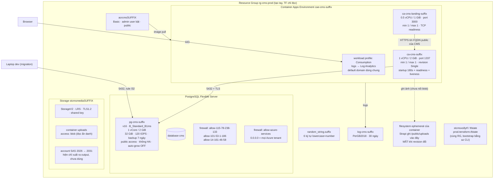
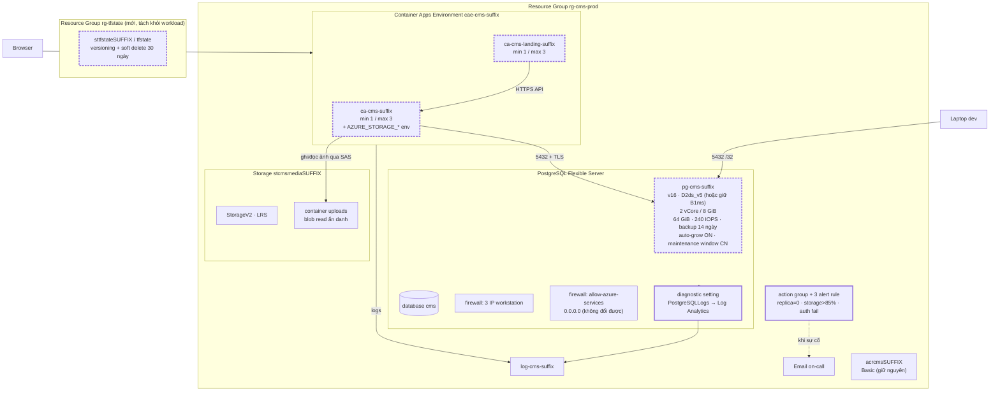

# Kế hoạch production: sơ đồ hiện tại → sơ đồ đích

Mục tiêu: app CMS + landing chạy ổn định, không downtime do deploy, không mất dữ liệu,
biết khi nào app chết. **Không** thêm VNet, Private Endpoint, Front Door, Key Vault.

Số liệu giá: list price `southafricanorth`, retail price API + calculator API, 730h/tháng (2026-11).

---

## 0. TL;DR — 5 việc đáng làm nhất

| # | Việc | Vì sao (mất gì nếu không làm) | Giá |
|---|---|---|---|
| 1 | Nối Blob vào Strapi (`AZURE_STORAGE_*`) | **Mất toàn bộ ảnh upload mỗi lần deploy/restart** — Strapi đang ghi vào filesystem ephemeral | $0 |
| 2 | `auto_grow_enabled = true` | DB chạm 95% → **read-only**, app 500, phải sửa tay | $0 |
| 3 | `max_replicas` 1 → 3 (cả 2 app) | 1 replica = 1 điểm chết; không có chỗ scale khi spike | $0 khi idle |
| 4 | Backup retention 7 → 14/30 ngày | Cửa sổ PITR chỉ 7 ngày | ~$0 |
| 5 | Đưa state sang RG riêng + versioning | Xoá `rg-cms-prod` = mất cả infra **và** state; mất state = mất `APP_KEYS`, `ENCRYPTION_KEY` | ~$1 |

Tổng cộng: **< $10/tháng**. Không cần thêm resource hạ tầng nào.

---

## 1. "Không add firewall rule thì không ai vào DB được" — đúng một nửa

Đúng: **nếu server không có rule nào**, public endpoint không cho ai vào.

Sai ở chỗ repo này **đang có rule `0.0.0.0`**, và nó không phải "IP của bạn":

```hcl
# environments/prod/terraform.tfvars
postgres_allow_azure_services = true   # → rule allow-azure-services 0.0.0.0/0.0.0.0
allowed_client_ips            = ["115.78.238.133", "101.53.1.186", "14.161.46.58"]
```

Tài liệu Microsoft, nguyên văn:

> The *Allow public access from any Azure service within Azure to this server* option configures the
> firewall to allow all connections from Azure, **including connections from the subscriptions of
> other customers**.
> — <https://learn.microsoft.com/azure/postgresql/security/security-firewall-rules>

Nghĩa là: mọi VM/Container App/Azure Function của **bất kỳ tenant nào** đều vào được port 5432
nếu biết `host + user + password`. Rule này **không thể bỏ** khi không có VNet, vì ACA egress
không có IP tĩnh.

Vậy trên thực tế thứ duy nhất bảo vệ DB là:

| Lớp | Trạng thái hiện tại |
|---|---|
| FQDN khó đoán (`pg-cms-<6 ký tự random>`) | Có, nhưng không phải control |
| Mật khẩu | 12 ký tự, pattern con người đặt (xem `terraform.tfvars`) — nằm plaintext trong tfvars, trong state blob, và trong ACA secret |
| TLS | App dùng `DATABASE_SSL=true` + verify cert; server-side `require_secure_transport` không được khai báo trong repo |
| Audit log đăng nhập sai | **Không có** (PG chưa bật diagnostic setting) |

→ Việc đúng không phải "thêm VNet", mà là: **mật khẩu 32 ký tự random + bật log + alert khi có
nhiều lần auth fail**. Ba việc đó rẻ hơn VNet ~$70/tháng và đủ cho mức an toàn bạn cần.

Ghi chú: rule `/32` của 3 IP workstation bạn tự kiểm soát — xoá lúc nào cũng được, ACA không
phụ thuộc vào chúng.

---

## 2. Sơ đồ hiện tại (theo resource)



Đọc sơ đồ: **không có VNet, không có NSG, không có Front Door, không có private endpoint.**
`0.0.0.0` là đường duy nhất để CMS vào DB. Blob tồn tại nhưng **không nối vào CMS** — mũi tên
nét đứt là dữ liệu sẽ mất.

---

## 3. Sự cố nào xảy ra thì điều gì hỏng (hiện tại)

Đây là căn cứ để chọn việc, không phải danh sách "best practice".

| Sự kiện | Hành vi hiện tại |
|---|---|
| Deploy image mới | Revision mới boot 1–3 phút (revision cũ vẫn phục vụ, không downtime); **ảnh upload mất** nếu Strapi ghi local |
| Container restart / node lỗi | 1 replica duy nhất → **downtime 1–3 phút** (Strapi boot lại, startup probe cho tới 180s) |
| Spike > ~10 request đồng thời | `max_replicas = 1` → request xếp hàng, latency tăng |
| DB đầy 95% | `auto_grow = false` → **server read-only** → toàn bộ write 500 |
| B1ms hết CPU credit | Query chậm 5–10s, request timeout; **probe không phát hiện** (`/_health` của Strapi không kiểm tra DB) → không tự restart, không alert |
| DB patch/maintenance | Azure chọn giờ ngẫu nhiên (chưa có maintenance window) → restart 30–90s |
| Migration sai / xoá dữ liệu | PITR **chỉ trong 7 ngày** |
| Xoá nhầm RG | Mất infra **và mất state**; `APP_KEYS`/`ENCRYPTION_KEY` sinh lại → admin session chết, field đã mã hoá không đọc được |
| `terraform destroy` nhầm | Không có `prevent_destroy` → DB, ACR, storage bị xoá |
| Năm 2031 | SAS hết hạn → upload fail (nếu đã nối SAS vào CMS) |
| CMS chết | Landing vẫn sống nhưng trang chưa cache trả lỗi (app-level, không phải infra) |
| Không ai biết app chết | **Không có alert nào** — 0 alert hiện tại |

Điểm quan trọng: deploy **không** gây downtime (ACA Single mode provisioning revision mới rồi mới
chuyển traffic — nguồn: docs `container-apps/revisions`). Cái gây downtime là **1 replica** và
**DB read-only**, không phải deploy.

---

## 4. Sơ đồ đích

Nét đứt dày = resource có thay đổi. Mọi thứ khác giữ nguyên.



Không có node nào bị xoá. Sơ đồ đích = sơ đồ hiện tại + 6 thay đổi cấu hình + 2 resource cấu
hình (diagnostic setting, alert).

---

## 5. Delta: từ gì → thành gì

### P0 — làm ngay (dưới 1 giờ, không recreate gì)

| Resource | Hiện tại | Đích | Vì sao | Recreate? | $/tháng |
|---|---|---|---|---|---|
| `azurerm_container_app.headless_cms` | không có env storage | thêm `AZURE_STORAGE_CONTAINER_NAME` + `AZURE_STORAGE_SAS_URL` (hai tên này đã có trong `outputs.tf`) và account name theo app, lấy từ `module.blob` | ảnh upload mất mỗi deploy | Không (revision mới) | $0 |
| `postgres` | `auto_grow_enabled` không set (= false) | `auto_grow_enabled = true` | DB read-only ở 95% | Không | $0 |
| `postgres` | `backup_retention_days = 7` | `14` | cửa sổ PITR | Không | ~$0 |
| `headless-cms` | `max_replicas = 1` | `3` | 1 replica = 1 điểm chết; không scale | Không | $0 (idle) |
| `landing` | `max_replicas = 1` | `3` | như trên | Không | $0 (idle) |
| `postgres` | password 12 ký tự trong tfvars | 32 ký tự random, qua `TF_VAR_postgres_admin_password` | control duy nhất khi `0.0.0.0` mở | Không | $0 |

Lưu ý khi đổi password: server đổi trước, container nhận secret mới cùng lúc → **1–3 phút 503**
lúc Strapi boot. Làm ngoài giờ cao điểm.

Việc #1 cần sửa ở **app repo**, không phải infra: Strapi phải có upload provider Azure
(`@strapi/provider-upload-azure-storage`) và đọc 3 env trên. Infra chỉ thêm env + truyền
`module.blob` output vào `module.headless_cms`.

### P1 — trong tuần này

| Resource | Hiện tại | Đích | Vì sao | Recreate? | $/tháng |
|---|---|---|---|---|---|
| backend state | blob trong `rg-cms-prod` | RG + storage account riêng, `versioning` + `soft delete 30 ngày` | mất RG = mất state + mất secret không tái tạo được | Không (`init -migrate-state`) | ~$1 |
| `postgres` | không có `prevent_destroy` | `lifecycle { prevent_destroy = true }` | chặn `destroy`/replace nhầm | Không | $0 |
| `blob` | không có bảo vệ | `prevent_destroy` trên storage account | uploads là dữ liệu thật | Không | $0 |
| `postgres` | maintenance window hệ thống | `maintenance_window` CN 00:00 UTC (02:00 SAST) | patch rơi ngoài giờ dùng | Không | $0 |
| `postgres` | không có log | `azurerm_monitor_diagnostic_setting` category `PostgreSQLLogs` → `log-cms-suffix` | hiện không có log DB nào để debug | Không | ~$1 |
| monitoring | 0 alert | action group email + alert: `Replicas < 1` (cả 2 app), `storage_percent > 85`, `cpu_credits_remaining` thấp (nếu giữ B1ms), log alert `password authentication failed` | không biết khi app/DB chết | Không | ~$0.3 |

Tên metric cần xác nhận trong Metrics Explorer trước khi viết Terraform:
`Replicas` (Microsoft.App/containerApps), `storage_percent`, `cpu_credits_remaining`
(PostgreSQL Flexible Server). Đừng copy mù.

### P2 — khi cần

| Resource | Hiện tại | Đích | Vì sao | Recreate? | $/tháng |
|---|---|---|---|---|---|
| `postgres` sku | `B_Standard_B1ms` | `GP_Standard_D2ds_v5` | B-series là burstable, MS khuyến cáo không dùng production; hết credit → app timeout | Không (restart) | +$155 |
| `postgres` storage | 32 GiB / 120 IOPS | 64 GiB / 240 IOPS | IOPS thấp dưới tải migration/admin | Không (chỉ tăng) | +$4.8 |
| backup logic | chỉ PITR trong Azure | ACA Job chạy `pg_dump` → container `backups` | backup portability, chống xoá cả server | Không | ~$0.1 |
| `acr` | admin user + password | managed identity + `AcrPull` | nợ kỹ thuật, bị chặn bởi RBAC hiện tại | Không | $0 |

### Bậc giá SKU (list, 730h)

| SKU | vCore / RAM | $/tháng | Ghi chú |
|---|---|---:|---|
| `B_Standard_B1ms` | 1 / 2 GiB | **$15.7** | hiện tại; 640 IOPS trần, CPU credit |
| `B_Standard_B2s` | 2 / 4 GiB | $62.8 | vẫn burstable |
| `B_Standard_B2ms` | 2 / 4 GiB | $125.6 | giá gần bằng GP → **không nên chọn** |
| `GP_Standard_D2ds_v5` | 2 / 8 GiB | **$170.8** | SKU production hợp lý; HA zone-redundant = ×2 |

Quyết định: nếu site là mặt tiền kinh doanh → D2ds_v5. Nếu lưu lượng rất thấp và chấp nhận
giám sát credit → giữ B1ms + alert `cpu_credits_remaining`, và bỏ qua B2s/B2ms vì giá không
tương xứng.

---

## 6. Những thứ **không** làm (và khi nào xem lại)

| Không làm | Vì sao | Xem lại khi |
|---|---|---|
| VNet + NAT Gateway + Private Endpoint | +$70/tháng, recreate environment, mất đường migration từ laptop. Không giải quyết vấn đề ổn định nào ở bảng §3 | DB bắt buộc private (compliance), hoặc cần egress IP tĩnh để allowlist |
| Front Door | ACA đã có domain + TLS. FD không giảm downtime (origin vẫn public với Standard) | Cần WAF/rate limit thật, hoặc cần DNS không đổi khi recreate env |
| Zone-redundant HA | ×2 compute (~+$171/tháng) cho app 30k request/tháng | SLA 99.99% thành yêu cầu hợp đồng |
| Key Vault | Secret đang nằm trong ACA secret (mã hoá at-rest) và state; thêm KV = thêm một chỗ phải đồng bộ, chưa giải quyết vấn đề ổn định nào | Khi có nhiều app/team cùng đọc secret, hoặc cần rotate tập trung |
| Multi-region | Không có traffic toàn cầu | Traffic ngoài châu Phi chiếm đa số |
| Bỏ rule `0.0.0.0` | Không thể, ACA egress không có IP tĩnh. Bỏ = app không kết nối được DB | Khi có VNet + NAT |

**Không có resource nào nên xoá** trong sơ đồ hiện tại. `sas_start`/`sas_expiry` cố định tới
2031 là thứ duy nhất cần ghi lịch nhắc (hoặc chuyển sang account key khi nối blob).

---

## 7. Thứ tự thực hiện

1. **Infra PR #1** (P0, không recreate): `auto_grow`, `backup_retention_days = 14`, `max_replicas = 3`.
   `terraform plan` phải chỉ ra **toàn bộ là in-place**.
2. **App PR**: thêm upload provider + đọc `AZURE_STORAGE_*`; infra PR #2 truyền env từ
   `module.blob` vào `module.headless_cms` (đổi signature module).
3. **Password rotation** trong maintenance window (chấp nhận 1–3 phút 503).
4. **State migration**: tạo `rg-tfstate` + storage account, bật versioning/soft delete,
   `terraform init -migrate-state`, xác nhận `terraform plan` rỗng.
5. **P1 còn lại**: `prevent_destroy`, `maintenance_window`, diagnostic setting, alerts.
6. **SKU** (P2) sau khi xem metric 1–2 tuần: nếu `cpu_credits_remaining` chạm đáy hoặc
   `cpu_percent` > 70% kéo dài → lên `D2ds_v5`.

Kiểm tra sau mỗi bước: `terraform plan` không có `-/+ destroy`, và URL CMS/landing trả 200.

---

*Nguồn sự thật: code trong `modules/`, `environments/prod/terraform.tfvars`, và
`docs/azure-primer.vi.md` (giải thích khái niệm). File này là plan, không phải mô tả trạng thái
đã áp dụng.*
